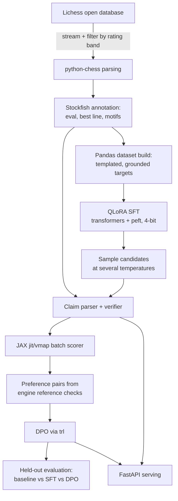
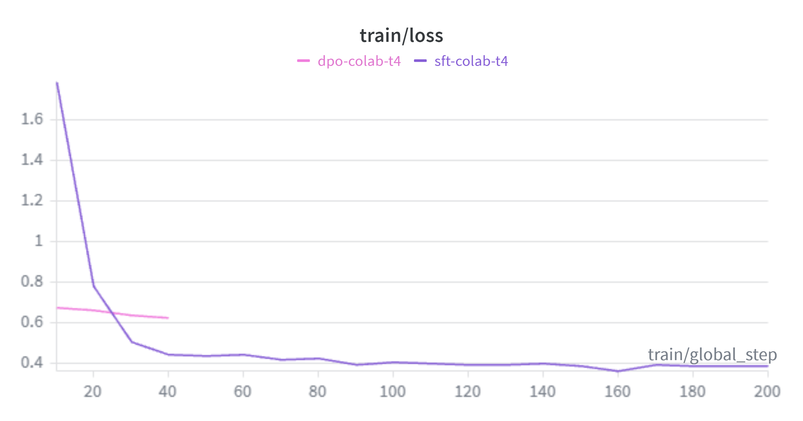

# opening-theory-engine

[](https://github.com/ariyan-tipu/opening-theory-engine/actions/workflows/ci.yml)
[](LICENSE)

A chess engine tells you the best move but never why. A general chatbot happily
tells you why, and is regularly wrong about it in ways that sound convincing.
This project sits in the gap: a small fine-tuned language model that explains
chess opening moves, with **an evaluation suite that checks what it says
against Stockfish** at a fixed depth rather than against anyone's opinion.

That suite is the result. After QLoRA fine-tuning and DPO alignment, **only 2%
of responses survive end-to-end verification**, and the tuned models quote an
illegal move in about 95% of their engine lines. That is the kind of confident,
plausible-sounding failure a subjective rating misses, and it is the number this
repository leads with.

The alignment data is built the same way, from **engine evidence with no human
labels**. Candidate explanations are sampled at several temperatures, a
deterministic parser extracts each factual claim ("this wins a pawn", "better
was d4", the quoted engine line), and each claim the parser recognises is
checked against Stockfish's evaluation, principal variation and material
arithmetic. The answer that evidence most supports becomes the chosen side of a
DPO pair and a weaker or hallucinated one the rejected side, never preferring an
answer that makes more factual errors than its partner.

Two scope notes worth having up front. The reference is a finite-depth engine
search (depth 14 in the run below, 10 in the laptop profile), so it is a strong
reference rather than literal truth. And only claims the parser recognises can
be checked: a sentence it cannot parse is left out of the count altogether,
which is why the parser's coverage is part of the method rather than
an implementation detail.

## How it works



The same verifier runs in three places, so the numbers all mean the same
thing:

1. **Alignment**: scoring candidates to build DPO pairs.
2. **Evaluation**: the factual accuracy figures in the results table.
3. **Serving**: every API response ships with its verification report, and a
   failed check triggers one regeneration before the best attempt is returned
   with the evidence attached.

## Results

The evaluation compares the plain instruct model, the SFT adapter and the DPO
adapter on 150 held-out positions no training stage has seen, with greedy
decoding and identical prompts. Every metric is an engine-checked count from
the same deterministic verifier. The run was trained
on a free Colab T4; the loss and reward curves are on
[Weights & Biases](https://wandb.ai/ariyantipu39-city-university-of-london/opening-theory-engine).

Bold marks the best value in each row, including the three rows where the
baseline wins.

| Metric (150 positions) | baseline | SFT | DPO |
| --- | --- | --- | --- |
| format compliance | 0.01 | **1.00** | **1.00** |
| verdict exact match | 0.29 | **0.50** | **0.50** |
| verdict within one band | **0.95** | 0.79 | 0.79 |
| eval within one band | **1.00** | 0.90 | 0.89 |
| claim precision | 0.47 | 0.572 | **0.575** |
| hallucinations per response (lower is better) | **1.48** | 1.76 | 1.71 |
| composite factual score | -2.89 | -1.36 | **-1.32** |
| repeated-text rate | 0.09 | **0.00** | **0.00** |
| **fully verified responses** | 0.00 | **0.02** | **0.02** |

The last row is the one to read first. "Fully verified" means the response
was correctly formatted *and* the engine could not refute a single claim in
it. Two per cent of the time. Every other row is a partial credit score;
that one is the end-to-end question, and the answer is that this model is
not fit to be trusted unsupervised.



What the numbers say:

- **Fine-tuning works.** The base model almost never produces the structured
  format (1%); after SFT it always does (100%), verdict accuracy nearly
  doubles, and claim precision and the composite factual score improve sharply.
- **DPO moved the metrics it optimised, by an amount this evaluation cannot
  separate from noise.** Claim precision went from 0.5721 to 0.5745,
  hallucinations from 1.76 to 1.71, the composite from -1.36 to -1.32: all the
  right direction, all tiny. This is a single run over 150 positions with one
  seed and no confidence interval, so the correct reading is "no measurable
  regression, plausibly a small improvement", not "DPO worked". Establishing
  the latter needs repeated seeds and an interval, which a free-tier budget
  (200 SFT steps, 46 DPO steps over 180 pairs) did not stretch to. The
  reward-accuracy curve did climb cleanly to 0.84, which says the objective
  was learnable; it does not say the generation got better.
- **The three rows the baseline wins all carry a denominator caveat.** Verdict
  and evaluation distances only exist where the field can be parsed, so those
  rates score the baseline on the sliver of responses where it committed to
  something parseable: a perfect eval column from a model that produces the
  format 1% of the time says how small that sliver is. Hallucinations per
  response is the same effect in another guise, since a model that rarely
  emits the format rarely offers the parser anything to refute. Vagueness
  scores well on both, which is why neither is the headline.
  [docs/results.md](docs/results.md) works through it.
- **The clearest limitation the verifier exposes:** the fine-tuned models quote
  an illegal move somewhere in their engine line about 95% of the time. A
  lightly tuned 3B model can learn the format and get the verdict right, but
  reliably generating a fully legal multi-move continuation is beyond it. This
  is exactly the kind of confident, plausible-sounding hallucination that
  subjective rating misses and that this project's verifier catches.

Full numbers are in [results/summary.md](results/summary.md) and
[results/summary.json](results/summary.json), the dataset behind them is
described in [results/dataset_card.md](results/dataset_card.md), and the
methodology and a longer discussion are in [docs/results.md](docs/results.md).

## Quickstart on a laptop (no GPU, about five minutes)

```bash
git clone https://github.com/ariyan-tipu/opening-theory-engine.git
cd opening-theory-engine
python -m venv .venv
source .venv/bin/activate          # Windows PowerShell: .venv\Scripts\Activate.ps1
pip install -e ".[dev]"
pytest                             # engine tests auto-skip until Stockfish is set up
```

Fetch the pinned engine and prove the whole data pipeline on a real slice of
the Lichess database (small, capped, single engine thread):

```bash
ote engine fetch                   # prints the binary path
export STOCKFISH_PATH=~/.opening-theory-engine/stockfish/stockfish
# Windows PowerShell: $env:STOCKFISH_PATH="$env:USERPROFILE\.opening-theory-engine\stockfish\stockfish.exe"
ote data build --config configs/laptop.yaml
```

Then run the API with the stub explainer (no model download) and the real
engine doing live verification:

```bash
OTE_ENGINE=stockfish ote serve
```

```bash
curl -s -X POST http://127.0.0.1:8000/explain \
  -H 'Content-Type: application/json' \
  -d '{"fen": "rnbqkbnr/pppppppp/8/8/8/8/PPPPPPPP/RNBQKBNR w KQkq - 0 1", "move": "e4"}'
```

Interactive docs live at `http://127.0.0.1:8000/docs`.

## The real training run (free GPU)

Training runs on a free Colab T4; the code is not Colab-specific and the same
commands run unchanged on any CUDA box (an AWS EC2 `g4dn.xlarge` carries the
same T4 if you would rather rent). Each notebook is thin: it clones this
repository, installs it and drives the CLI. The working directory sits on
Google Drive, so the annotation cache and adapters survive session recycling
and every stage resumes rather than restarts.

| Notebook | What it does | Runtime | Rough time |
| --- | --- | --- | --- |
| [01_build_dataset](notebooks/01_build_dataset.ipynb) | stream, filter, annotate with Stockfish, write datasets | CPU | 2 to 3 h |
| [02_train_sft](notebooks/02_train_sft.ipynb) | QLoRA SFT of Qwen2.5-3B-Instruct in 4-bit | T4 | 1 to 2 h |
| [03_align_dpo](notebooks/03_align_dpo.ipynb) | sample candidates, verify, JAX-score, build pairs, DPO | T4 | 1 to 2 h |
| [04_evaluate_and_demo](notebooks/04_evaluate_and_demo.ipynb) | held-out eval plus a live API demo with real weights | T4 | 30 to 60 min |

Open them straight in Colab, for example:
`https://colab.research.google.com/github/ariyan-tipu/opening-theory-engine/blob/main/notebooks/01_build_dataset.ipynb`

Weights & Biases tracking is wired into both training stages. Log in inside
the notebook and you get live loss curves; skip it and runs log offline. Set
`wandb.mode` in the config to control this per profile.

## Serving

The API has two independent backends, both behind `OTE_*` environment
variables:

- `OTE_BACKEND=stub` (default): a template renderer stands in for the model.
  Instant, deterministic, no downloads; this is what CI smoke-tests.
- `OTE_BACKEND=hf`: the real model. Point `OTE_BASE_ID` and
  `OTE_ADAPTER_PATH` at your trained adapter; set `OTE_FOUR_BIT=true` on a
  CUDA machine.

The adapters from the executed run are attached to the
[v0.1.0 release](https://github.com/ariyan-tipu/opening-theory-engine/releases/tag/v0.1.0),
so you can serve the real model without training anything:

```bash
unzip dpo-adapter.zip
OTE_BACKEND=hf OTE_BASE_ID=Qwen/Qwen2.5-3B-Instruct \
OTE_ADAPTER_PATH=dpo-adapter OTE_ENGINE=stockfish ote serve
```

Docker (the image bundles a checksum-verified Stockfish and defaults to the
stub backend):

```bash
docker build -t opening-theory-engine .
docker run --rm -p 8000:8000 opening-theory-engine
```

Every `/explain` response carries the full evidence trail: the engine's best
move and line, the parsed claims, each claim's verdict and how many attempts
the explainer needed. Throughput note: inference is plain Hugging Face
`generate()` behind a request lock, which is entirely adequate for a solo
project at this scale; the considered next step for real traffic is vLLM with
paged attention and continuous batching, not more threads in front of
`generate()`.

## Project layout

```
configs/            one YAML per run profile (laptop smoke, Colab T4)
notebooks/          four thin Colab notebooks that drive the CLI
src/opening_theory_engine/
  engine/           Stockfish wrapper, facts dataclasses, pinned fetcher, stub
  data/             streaming, filtering, motifs, annotation cache, dataset build
  alignment/        claim parser, verifier, JAX scorer, pair builder
  training/         QLoRA SFT, candidate sampling, DPO (transformers/peft/trl)
  agent/            explainer backends + the explain-verify-regenerate loop
  evaluation/       held-out comparison and metrics
  serving/          FastAPI app and schemas
  cli.py            the `ote` command
tests/              unit tests plus engine-marked and train-marked suites
results/            committed artefacts from the executed run (summary, dataset card)
```

## Design notes

The full decision log is in [docs/design.md](docs/design.md): the
3B-versus-7B VRAM arithmetic, why fp16 rather than bf16 on a T4, why the SFT
targets are templated from engine facts, the guards against the model gaming
the scorer, and the scale note on JAX. Evaluation methodology lives in
[docs/results.md](docs/results.md).

## Licence and acknowledgements

GPL-3.0-or-later, because the project links against
[python-chess](https://github.com/niklasf/python-chess), which is GPL. Game
data comes from the [Lichess open database](https://database.lichess.org)
(CC0). Stockfish is fetched from its official releases and never bundled.
Qwen2.5-3B-Instruct is used under the Qwen Research Licence (research and
non-commercial use; swap in Qwen2.5-1.5B-Instruct for a fully Apache-2.0
stack). Details in [NOTICE.md](NOTICE.md).

Copyright (c) 2026 Ariyan Mohammed Tipu.
