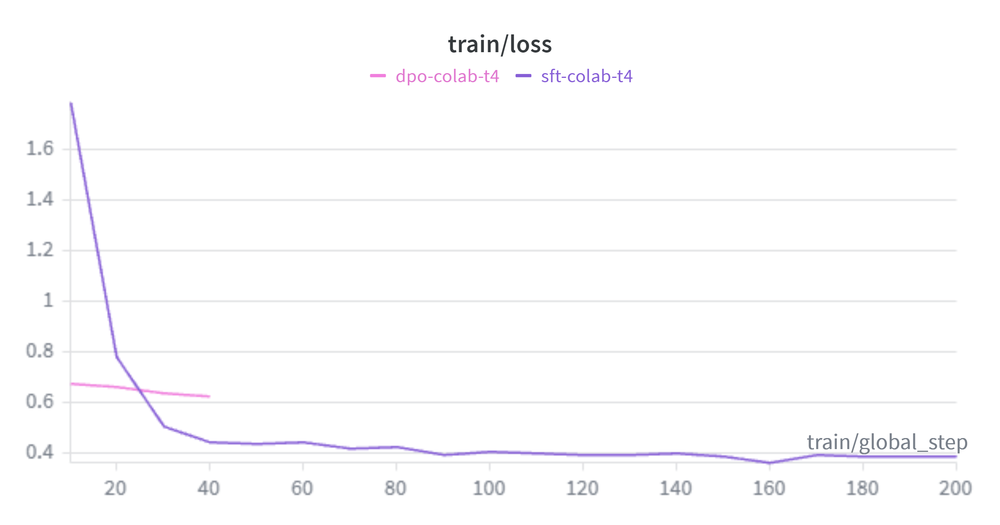
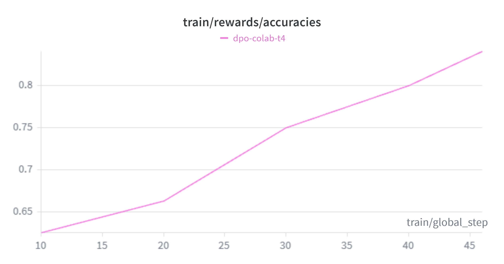
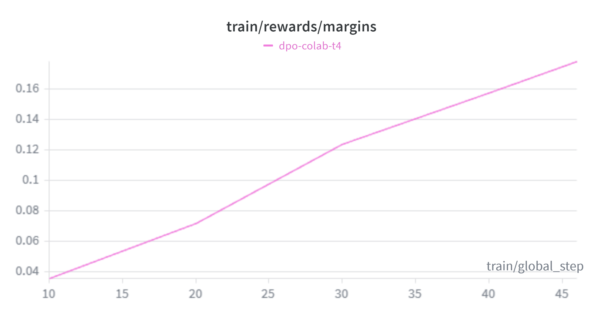

# Evaluation methodology and results

## The run this reports

Every number here comes from one real run on a free Colab T4, using
`configs/colab-t4.yaml`:

- **Data**: the August 2014 Lichess export, filtered to games where both
  players were rated 1800 to 2392. 8,993 unique opening positions from 7,177
  games, annotated with Stockfish 18 (depth 14, MultiPV 2), split at game level
  into 6,349 train / 1,791 align / 853 eval. Balanced across all five ECO
  families (A to E). The median centipawn loss of the played moves is 11, so
  the positions are mostly sound.
- **SFT**: QLoRA on Qwen2.5-3B-Instruct in 4-bit, 200 steps, final training
  loss 0.498.
- **Alignment**: 900 candidate explanations (180 align positions at five
  temperatures), scored by the verifier, giving 180 preference pairs.
- **DPO**: 46 steps over those pairs (two epochs), final loss 0.644. The
  reward margin between chosen and rejected rose from 0.04 to 0.18 and reward
  accuracy climbed from 0.63 to 0.84 across the run.

Loss and reward curves for both stages are on
[Weights & Biases](https://wandb.ai/ariyantipu39-city-university-of-london/opening-theory-engine),
and the headline charts are committed below.

The purple SFT loss falls from 1.78 to about 0.4 over the 200 steps; the short
pink segment is the DPO stage's own loss over its 46 steps. The two DPO reward
curves show the alignment signal at work:

Reward accuracy (how often the model ranks the chosen answer above the
rejected one) climbs from 0.63 to 0.84, and the reward margin widens from 0.04
to 0.18, still rising when the run ends.

## Method

Three systems answer the same held-out positions with greedy decoding and
identical prompts:

- **baseline**: Qwen2.5-3B-Instruct as shipped, zero-shot.
- **sft**: the QLoRA adapter after supervised fine-tuning.
- **dpo**: the adapter after preference alignment on engine-verified pairs.

Every response goes through the same claim parser and verifier used in
training, against facts computed once during annotation. Splits are assigned at
game level, so no evaluation position shares a game with anything a training
stage saw.

## Results (150 held-out positions)

| Metric | baseline | sft | dpo |
| --- | --- | --- | --- |
| format_rate | 0.0133 | 1.0 | 1.0 |
| verdict_exact | 0.2933 | 0.5 | 0.5 |
| verdict_within_one | 0.9467 | 0.7933 | 0.7933 |
| eval_within_one | 1.0 | 0.9 | 0.8933 |
| line_illegal_rate | 0.6667 | 0.9533 | 0.96 |
| claim_precision | 0.4702 | 0.5721 | 0.5745 |
| hallucination_rate | 1.48 | 1.76 | 1.7133 |
| verified_pass_rate | 0.0 | 0.02 | 0.02 |
| composite_score_mean | -2.8913 | -1.3601 | -1.3211 |
| fluency: mean_tokens | 75.91 | 34.71 | 36.92 |
| fluency: distinct_2 | 0.9781 | 0.995 | 0.9996 |
| fluency: repetition_rate | 0.0933 | 0.0 | 0.0 |

## Reading the numbers

**Supervised fine-tuning did its job.** Format compliance goes from 1% to
100%: the base model almost never produces the four-line structure, and the
tuned model always does. Verdict exact-match nearly doubles (0.29 to 0.50),
claim precision rises from 0.47 to 0.57, the composite factual score more than
halves its distance from zero (-2.89 to -1.36), and the prose stops repeating
itself.

**DPO gives a small but real gain on exactly what it optimised.** From SFT to
DPO, claim precision rises (0.5721 to 0.5745), hallucinations per response fall
(1.76 to 1.71), and the composite score improves (-1.360 to -1.321). These are
the quantities the preference pairs were built from, and they all move the
right way, driven only by engine reference checks with no human labels. The gain is
deliberately modest: this was a short free-tier run (200 SFT steps, 46 DPO
steps). The point is that the direction is correct and measurable, and the
reward curve during training climbed cleanly, so more compute is expected to
widen the gap rather than change its sign.

**The limitations the verifier exposes are the interesting part.** Several
metrics read worse for the tuned models, each for a reason worth spelling out:

- `line_illegal_rate` is about 0.95 for SFT and DPO. Roughly 95% of the tuned
  models' quoted engine lines contain at least one illegal move. Generating a
  legal multi-move continuation in standard notation is genuinely hard for a
  3B model at this training budget: it produces plausible-looking but often
  illegal moves.
- `hallucination_rate` is slightly higher for the tuned models (1.76 vs 1.48)
  because they actually produce full, checkable responses. The baseline rarely
  produces a parseable structure at all, so it has fewer claims to get wrong.
  `claim_precision` (the fraction of checkable claims that are correct) is the
  fairer comparison, and it improves.
- `verdict_within_one` and `eval_within_one` favour the baseline, but the
  denominators differ. A distance exists only where the field can be parsed
  from the response, so these rates score the baseline on the subset of
  responses where it committed to something parseable; an `eval_exact` of
  1.00 from a model with a 1% format rate shows how small that subset is for
  evaluations. The tuned models produce a parseable verdict and evaluation
  for every position and aim for the exact band, so exact matches nearly
  double while the within-one rate falls.

This is the whole argument for the project. A subjective rater, or a generic
chatbot judging itself, would likely wave through a fluent explanation that
quotes an illegal line. The deterministic verifier does not: it replays every
quoted move and flags the illegal ones, which is why `verified_pass_rate` (a
response passing every single check) is only 2% here. That number is harsh on
purpose.

## The live serving demo

Notebook 04 also runs the real FastAPI service against the DPO adapter and
Stockfish 18. A `/explain` request for `1. e4` returned a verified explanation
(`"passed": true`, factual accuracy 1.0) whose quoted line was legal and
matched the engine, with the full evidence trail attached. That is proof the
serving path works end to end with real weights as well as with the stub used in CI.

## What I would do with more compute

- Train SFT for a full epoch or two rather than 200 steps, which should lift
  the legal-line rate the most.
- Add a lightweight legality constraint or reranking at generation time so the
  model cannot emit an illegal quoted line in the first place.
- Build more preference pairs (the align split has 1,791 positions; this run
  used 180) to give DPO a stronger signal.
